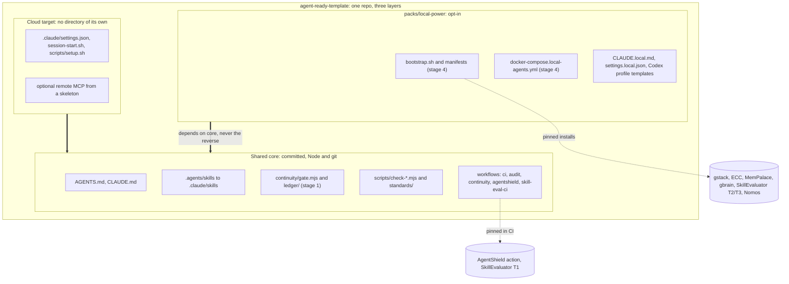
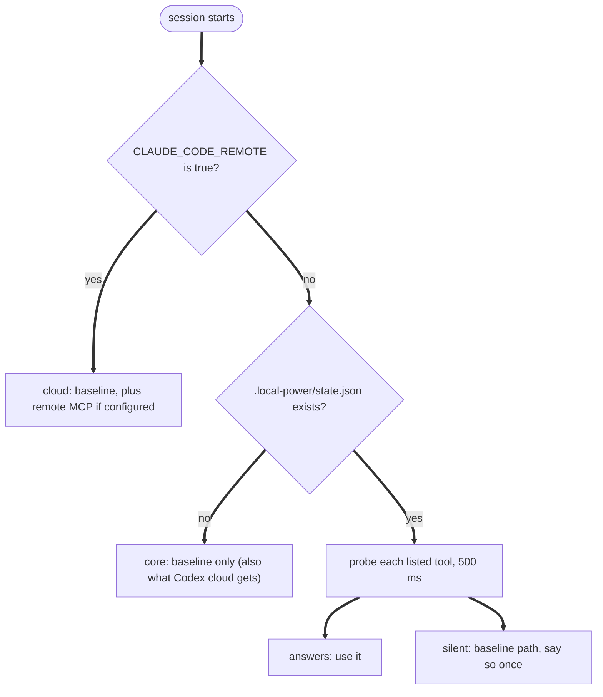

# A shared core, a cloud target, and a local power target for agents

Kind: FEATURE · Drawn up: 2026-11-17 · Owner: Joel Abraham · Status: IN PROGRESS (stages 0 through 3 implemented, stages 4 and 5 pending)

## Why

Agents work on this repository, and on every repository built from it, in two kinds of place: a
vendor's cloud container that starts from a fresh clone, and a person's machine that can run
local runtimes, containers, and user-level tools. A research report
(`final_architecture_report_live_upstream_vs_local_copy_20261117_190420.pdf`, the owner's input,
not in the repository) recommended consuming gstack, ECC, MemPalace, and gbrain live, owning a
small continuity gate, and keeping the template to what a cloud session can run. Two things were
added to it: the cloud's limits must never hold back a local session, and three more upstreams
(NVIDIA SkillEvaluator, NVIDIA Nomos, flutter/agent-plugins) had to be placed. The template has
no docs/product.md; this plan serves the mission in AGENTS.md "What this is": the process and
checks that keep agent-written work honest, in every environment an agent runs in.

## Behavior

- **Now:** the repository has one set of agent files for every session. Nothing says what a
  session may rely on in a cloud container versus on a real machine, nothing stops a local setup
  from being committed, and no gate covers agent configuration, skill content, or whether a
  decision a change relies on still holds.
- **After:**
  - Stage 0: every committed file works from a clean clone; `npm run agent:target` tells a
    session where it is; a local machine opts into more through `packs/local-power/` and files
    git ignores; tests hold the direction.
  - Stage 1: a continuity ledger in the repository records decisions with the files they rest
    on, and CI warns, then blocks, when a change cites or invalidates one that is no longer
    current.
  - Stage 2: CI scans agent configuration (AgentShield) and skill content (SkillEvaluator
    Tier 1) on every pull request, each with a planted-defect job.
  - Stage 3: `process:apply` delivers the gate and skeleton workflows to other repositories.
  - Stage 4: a bootstrap installs and pins the local tools; a Compose file runs the services.
  - Stage 5: a manual Skill Lift benchmark whose result becomes a ledger decision.
- **Unchanged:**
  - A clean clone needs only Node, git, and `npm ci` to run every committed check.
  - `process:apply` delivers no hook configuration, and never touches a target's own files.
  - `.claude/skills/` stays generated from `.agents/skills/`.
  - AGENTS.md plus CLAUDE.md stay within 200 lines, and AGENTS.md under 32 KiB.
  - Every workflow pins actions by commit and grants no token permission by default.

## Out of scope

- Extracting the process half into a second repository. The triggers are in ADR 0022.
- An execution adapter for Nomos (a hook that sends each command for authorization). Revisit
  when upstream ships its council-gate plugin, or the owner decides to own that hook.
- New standards for the catalog (`core.agent-config-scanned`, `core.continuity-verified`). They
  come through the harvest prompt once the checks have run here for a while.
- Cross-model review in CI. It costs credit on every pull request; local only for now.
- Replacing `TypeScript`'s compiler API in `check-conformance` and `check-env`, which holds
  TypeScript below 7. Flagged as the first coupling cost to watch, not fixed here.

## Against the rules

- AGENTS.md "Minimal diffs" and "Match existing conventions": follows, with one flagged
  departure. The gate lives in a top-level `continuity/` directory rather than `scripts/`,
  because a skill's text is shared between the template and its targets, so the gate needs one
  path in both, and the ledger belongs beside it. Its test stays in `scripts/__tests__/`.
- AGENTS.md Golden rule 1 (generated files): follows. New skills are written in
  `.agents/skills/` and rebuilt with `npm run skills:build`.
- AGENTS.md "Prove a check can fail before trusting it": follows. Every new test has a positive
  control, each new gate has a planted-defect job, and stage 0's were run against 19 planted
  defects.
- AGENTS.md "Installs aren't forced" and ADR 0019 (seven-day wait): follows. SkillEvaluator
  1.0.1 was published on 2026-11-18, so its gate lands on or after 2026-11-25.
- ADR 0002, 0006, 0016 (`process:apply` owns `prompts/` and the skills in a target): departs in
  stage 3, which delivers `continuity/gate.mjs` at a new top-level path. The stage 1 ADR records
  it. Stage 0 only adds two skeletons, which the existing rule covers.
- ADR 0007, 0011, 0020 (AGENTS.md holds the rules, sized for the selected agents): follows.
- ADR 0017 (actions pinned by commit, zizmor, actionlint): follows. The report's
  `affaan-m/agentshield@v1` is a moving tag; the plan pins the commit.
- ADR 0018 (one guard, one setup for every agent): follows. No hook is added.
- The ruleset test (every pull-request job is a required check): follows. Stage 1 adds one
  required check and stage 2 four; the owner re-imports the ruleset in Settings each time.
- New ADRs: 0022 (the three layers; written), then one each for the continuity ledger, the two
  CI gates, and the local power pack.

## Design

### What was verified, and how

Local facts were read from the repository. Upstream versions, tags, and counts were fetched on
2026-11-17 with `gh api`, `npm view`, and the PyPI JSON API. Upstream behavior was read from each
project's source and documentation; nothing upstream was installed or run. Platform facts were
read from the vendors' current documentation the same day.

**The seam.** The report's `standards/scripts/check-conformance.mjs` doesn't exist: the engine is
`scripts/check-conformance.mjs`, it finds the catalog at `standards/` beside itself, and it loads
`yaml`, `typescript`, `smol-toml`, and `json5` from the template's install through
`scripts/template-dependency.mjs`. Only `apply-process.mjs`, `check-placeholders.mjs`,
`agent-platforms.mjs`, and now `agent-target.mjs` use Node builtins alone. Where each file would go
if the repository were split is the table in
[ADR 0022](../adr/0022-shared-core-and-two-agent-targets.md).

**flutter/agent-plugins, as a packaging reference only.** One flat `skills/` directory and a thin
hand-written manifest per harness (`.claude-plugin/`, `.codex-plugin/`, `.cursor-plugin/`), no
build step, no symlinks. It removed its shared `.mcp.json` on 2026-09-17 for per-harness inline
MCP config, has no Gemini manifest and no lockfile, and its three plugin versions have drifted
with nothing checking them. `npx skills add flutter/agent-plugins --skill '*' --agent universal --yes`
is documented on docs.flutter.dev, not in its README. The `skills` CLI (1.9.0) sends telemetry
unless `DISABLE_TELEMETRY=1` and shipped three releases in the week checked, so it stays a
reference and is not adopted as a mechanism.

**Identifiers.**

| Upstream | Verified 2026-11-17 | The report or the brief said |
| --- | --- | --- |
| gstack | v1.100.0.0, tag commit `eff8b78dcef398ac11d0694f5e85ebd3a0a66940`. Not on npm (the npm package `gstack` is unrelated). A git clone plus `./setup`. Bun 1.4.2 or later. | v1.99.4.0, about 68 skills (62 and a router), daily releases (13 in 30 days) |
| `ecc-universal` | 2.2.3, Node 18 or later, bin `ecc`. `--guided` and `--harness` are real; without a terminal it needs `--yes --claude-scope --claude-hooks`. | 71 agents and 311 skills (68 and 293 at v2.2.3) |
| `ecc-agentshield` | 1.6.0, Node 20 or later, installed bin `agentshield`. The bare CLI fails only on critical findings. | — |
| `affaan-m/agentshield` | `v1` is a moving tag on `b0891303bdcd6037376a94263d45cfd2ff3dfb98` (v1.6.0). A bundled node24 action, no install at run time. Input `fail-on-findings` exists. Its discovery list has `.claude/skills/` and not `.agents/skills/`. No per-finding suppression, only a baseline file. | pin to `@v1` |
| `mempalace` | 3.12.0 on PyPI, Python 3.10 or later, bins `mempalace` and `mempalace-mcp`, ChromaDB embedded by default, an HTTP server mode with a bearer token. | confirmed |
| gbrain | v0.60.737.0, Bun 1.4.4 or later. Not on npm (the npm package `gbrain` is unrelated; upstream warns against it). About 439 releases in 30 days. Default engine is embedded PGLite. | needs Postgres |
| `skillevaluator` | 1.0.1 on PyPI, Python 3.12 to 3.14, published 2026-11-18. Support level "Experimental". Tier 1 downloads SkillSpector and Gitleaks on first run. | confirmed |
| NVIDIA/Nomos | Exists. Default branch `develop`, one tag `v0.1.0-beta`, 26 stars, alpha, Linux deploy only. Not on PyPI (the PyPI package `nomos` is unrelated). | see below |
| HOLO-Invariant | v0.4.9, 18 stars, 1,649 commits, six status values | 4 stars, about 904 commits, four statuses |

**Nomos, against the brief.** It is not a gateway other MCP servers sit behind: it exposes its own
review tools over MCP (streamable HTTP, port 9901), and an adapter the user writes sends each
command for a Writ and to an executor. It is not deterministic: only its OPA prefilter is, and
every approval needs LLM votes and a provider key. Its receipts are signed (Ed25519) but not
hash-linked; its council ledger is. Its Compose file uses `opa:latest`, binds services on
`0.0.0.0`, and defaults the Redis password. Its console points at a "council-gate" plugin for
Claude Code and Codex that isn't in the repository. It canonicalizes with Python `json.dumps`
and says it isn't RFC 8785.

**What each environment supports.** The table and the three facts it rests on are kept current in
[`docs/system/agent-targets.md`](../system/agent-targets.md). The ones that shaped the design:

- A single-repository session on Claude Code on the web loads the project's `.mcp.json` without
  an approval prompt, and no plugin or user-level skill or MCP server. A session over several
  repositories, or a thread in a Project, loads only CLAUDE.md. So CI is where a rule is enforced.
- Claude Code's cloud container ships Docker, Compose, PostgreSQL 16, Redis 7, uv, and Bun, none
  started. "No daemons in the cloud" is a choice for reproducibility, not a platform limit.
- Codex doesn't read `.mcp.json`. A profile is the file `~/.codex/<name>.config.toml` (since
  0.134; a `[profiles.<name>]` table is rejected), can't live in a repository, and is outranked
  by the project's own `.codex/config.toml`.
- `CLAUDE_CODE_REMOTE=true` identifies Claude Code cloud. Codex cloud documents no signal.
- The owner's machine is Windows 11. Natively, gstack promises four skills, gbrain ships no
  binary, Nomos doesn't deploy, SkillEvaluator is untested, and Claude Code's sandbox doesn't
  run. The local power target there means WSL2.

**Instruction hygiene**, against Anthropic's guide for Claude Fable 5.2, Claude Code's memory and
best-practices pages, and the current Codex guides:

| Property | AGENTS.md before | Change |
| --- | --- | --- |
| Ownership paired with scope | "Minimal diffs"; no ownership sentence | One sentence, scoped to the files a task touches. The guide measures it raising consolidation from under 10% to about 75% of runs with 70 to 80% more output, and says a scope rule alone doesn't cancel it. In the skeleton it is a placeholder the project decides. |
| Routine actions against ask-first | "Stop and agree a plan first", then "everything else: proceed" | The ask-first actions are named. The guide says "act more freely" is too vague and that "never" reads as absolute. |
| Where the session runs | Cloud setup only | A section, and a probe. |
| In-prompt budgets, think-less lines, sentence caps, blanket delegation | None | None added. |
| Retry and escalation | Three materially different failed approaches | Kept; an offline optional tool is not a blocker. |
| One source for each rule | A closing "Don't" list restated six rules | Folded away. |

**The four starting hypotheses.**

1. One ledger per repository with a `workstream` field, linkable to Nomos receipts: holds, with
   two amendments. A single linear hash-chained file conflicts on every append from parallel
   pull requests, which are the cloud target's main advantage, so storage is one immutable,
   content-addressed file per record. And the link references a Nomos receipt's payload digest
   or a ledger entry's `content_hash`, since the receipts themselves aren't chained.
2. A two-step rollout of the currency check: holds. The promotion criterion is in stage 1.
3. Memory off in the shared core and the cloud, opt-in locally: holds, with one correction.
   gbrain's default engine is embedded, so neither backend needs a daemon locally.
4. Shared core on the existing runtime, a declarative local bootstrap: holds, with one
   correction. The shared core today is "Node plus four npm packages", not builtins alone; the
   probe and the gate are builtins alone.

### The four challenges

1. **Extract a second repository now? No.** No second consumer exists, `process:apply` already
   distributes the process half, and the engine isn't self-contained. No `agents/` directory
   (`.agents/skills/`, `prompts/`, `standards/`, and `templates/` already are that) and no
   `packs/cloud/` (the cloud target is the committed baseline). Only `continuity/` and
   `packs/local-power/` are added.
2. **The minimum continuity interface, and the hand-off to Nomos.** Four operations (`append`,
   `revalidate`, `status`, `verify`), plus `is-current` and a `check` for CI. An unsigned chain
   is tamper-evident only against an anchor, and the anchor is git: against the base branch the
   ledger may only gain files. The gate never verifies a Nomos signature; it stores a digest, an
   id, and a key fingerprint in an optional `attestations` field, and verification stays in
   Nomos's own library on the local machine. Deterministic local control comes from each
   harness's own permission rules.
3. **Who evaluates what.**

   | Tool | Owns | Where |
   | --- | --- | --- |
   | `check:instructions` (ours) | Skill format, links, hidden characters, size | Everywhere |
   | AgentShield | Agent configuration: permissions, hooks, MCP config, secrets, `.claude/skills/` | CI gate |
   | SkillEvaluator Tier 1 | Skill content: security, PII, quality score, harness fit, on `.agents/skills/` | CI gate |
   | SkillEvaluator Tier 2 | Trigger overlap between our skills and installed upstream skills | Local, on demand |
   | `claude plugin eval` (existing) | Routing and behavior on Claude Code | Manual dispatch |
   | SkillEvaluator Tier 3 | Skill Lift across Claude Code and Codex | Local or manual dispatch |
   | gstack `/eval-plan` | Preregistration before a Tier 3 run | Local |

   Where the two format checks disagree, ours governs format and SkillEvaluator security.
4. **What failed verification.** In the report: the conformance path and "zero runtime
   dependencies in core"; gstack's version, skill count, and cadence; "Aside" (a third-party
   macOS browser; gstack's daemon is `browse`); `review-freshness` (the field is
   `review_freshness`, with a third grade); ECC's counts; `@v1` as a pin; gbrain needing
   Postgres; HOLO's numbers; "cloud sessions can't run services"; "the same SKILL.md runs
   unmodified" (Claude Code reads only `.claude/skills/`); "a project `.mcp.json` survives
   cloud" (Claude single-repository sessions only, never Codex); "about 50 lines" for the gate;
   "pin minor" for memory. In the brief: the four Nomos points above, a shared `.mcp.json` in
   flutter/agent-plugins, SkillEvaluator Tier 1 being offline, and a Codex profile living in the
   repository.

### The decision matrix

Class: LU live upstream, LC local contract, OLP optional local power, NN not needed. Support
columns: Claude Code local, Claude Code cloud, Codex local, Codex cloud, GitHub Actions; "yes",
"part", "no", or a dash where the row's tier doesn't cover that environment.

| # | Capability | Tier | Class | Coupling | Owner and runtime | Pin | CC local | CC cloud | Codex local | Codex cloud | CI |
| --- | --- | --- | --- | --- | --- | --- | --- | --- | --- | --- | --- |
| 1 | Ledger and receipts | Core | LC | CI, CONFIGURE | Template; Node builtins and git | In the repository, schema v1 | yes | yes | yes | yes | yes |
| 1 | | Cloud | LC | CALL | Same | Same | – | yes | – | yes | – |
| 1 | | Local | OLP: Nomos signed receipts, linked by digest | REFERENCE; CALL when on | NVIDIA; Compose and Python, Linux or WSL2 | A commit on `develop` | part | – | part | – | – |
| 2 | Content-bound revalidation | Core | LC | CI | Template; Node builtins | In the repository | yes | yes | yes | yes | yes |
| 2 | | Cloud | LC | CALL | Same | Same | – | yes | – | yes | – |
| 2 | | Local | LU: gstack `review_freshness` | INSTALL, CALL | gstack; Bun | Tag commit, update check off | yes | – | part | – | – |
| 3 | Stale or current enforcement | Core | LC | CI | Template; Node builtins | In the repository | yes | yes | yes | yes | yes |
| 3 | | Cloud | LC | CALL | Same | Same | – | yes | – | yes | – |
| 3 | | Local | LC: no upstream enforces it | CALL | Same | Same | yes | – | yes | – | – |
| 4 | Authorization and blast radius | Core | LC | CONFIGURE, CI | Harness permission rules, branch ruleset | In the repository | yes | yes | yes | part | yes |
| 4 | | Cloud | LC: container isolation, GitHub proxy | CONFIGURE | The platform | n/a | – | yes | – | yes | – |
| 4 | | Local | LC ask rules; OLP Nomos | CONFIGURE; REFERENCE | Template; Nomos experimental | In the repository; a commit | yes | – | yes | – | – |
| 5 | Skill quality and lift | Core | LU Tier 1, LC lint | CI | NVIDIA CI image with bundled scanners; template Node | Release-manifest digest, from 2026-11-25 | yes | part | yes | part | yes |
| 5 | | Cloud | LC lint only | CALL | Template; Node | In the repository | – | yes | – | yes | – |
| 5 | | Local | OLP Tier 2 and 3, `/eval-plan` | INSTALL, CALL | uv with Python 3.13, Docker; Bun | Exact version; Harbor 0.25.0 | yes | – | yes | – | part |
| 6 | Workflow skills | Core | LC: the ten process skills | CONFIGURE | Template | In the repository | yes | yes | yes | yes | – |
| 6 | | Cloud | LC | CONFIGURE | Same | Same | – | yes | – | yes | – |
| 6 | | Local | OLP: gstack and ECC | INSTALL | Bun; Node 18 or later | Tag commit; `ecc-universal@2.2.3` | yes | – | part | – | – |
| 7 | Memory | Core | NN: off by default | – | – | – | – | – | – | – | – |
| 7 | | Cloud | NN by default; LU remote MCP if configured | CONFIGURE | A self-hosted HTTP MCP server | The server's version | – | yes | – | part | – |
| 7 | | Local | OLP: MemPalace, then gbrain | INSTALL, CONFIGURE | uv; Bun, optional Compose pgvector | `mempalace==3.12.0`; a gbrain `stable-v` tag commit | yes | – | yes | – | – |
| 8 | Security scanning | Core | LU AgentShield and Tier 1 security; LC zizmor and audit | CI | A node24 action; `pipx` | Action commit (v1.6.0); exact version | yes | part | yes | part | yes |
| 8 | | Cloud | NN: CI covers it | – | – | – | – | – | – | – | – |
| 8 | | Local | OLP: a scan before pushing | CALL | `npx`, Node 20 or later | `ecc-agentshield@1.6.0` | yes | – | yes | – | – |
| 9 | Cross-model review | Core | LC: `review-change`, one model | CONFIGURE | Template | In the repository | yes | yes | yes | yes | – |
| 9 | | Cloud | LC only | CONFIGURE | Same | Same | – | part | – | part | – |
| 9 | | Local | OLP: gstack `/codex` and `/claude-code` | INSTALL, CALL | Bun; both CLIs signed in | Tag commit | yes | – | part | – | – |

Three choices behind it. Memory: MemPalace first (an exact PyPI pin, no daemon, uv already
needed), gbrain second for anyone in the gstack ecosystem, whose release rate makes pin upkeep
its main cost. gstack's team mode `required` is never adopted: it commits a hook that refuses
every skill call where no user-level install exists. Flutter's packaging and the `skills` CLI
stay a reference.

### Topology and routing





### Stage 0: the instruction and profile layer (built)

| File | What it is |
| --- | --- |
| `AGENTS.md` | "Agent setup" became "Where you are running"; the ask-first list joined "stop and agree a plan first"; the ownership sentence joined "Working on this template itself"; the closing "Don't" list was folded away to stay at 200 lines with CLAUDE.md |
| `CLAUDE.md` | One line: `CLAUDE.local.md` is personal and adds to it |
| `scripts/agent-target.mjs`, its `.d.mts` and test, the `agent:target` script | The probe: `cloud`, `local-power`, or `core`, then each listed tool. Looks commands up without running them, probes loopback only, 500 ms each, always exits 0 |
| `docs/system/agent-targets.md` | The three layers, detection, and what each environment supports |
| `.gitignore` | `CLAUDE.local.md` and `.local-power/` |
| `.claude/settings.json` | Denies `npm install`, `npm i`, and `npm ci` with `--force` or `--legacy-peer-deps`, for Bash and PowerShell. No allow, no ask |
| `.codex/rules/blast-radius.rules` | Codex prompts before the ask-first commands and forbids a forced install. Checked with `codex execpolicy check` |
| `packs/local-power/` | A README and three templates: `claude/CLAUDE.local.md.tmpl`, `claude/settings.local.json.tmpl`, `codex/local-power.config.toml.tmpl` |
| `templates/project/mcp.skeleton.json`, `codex-config.skeleton.toml` | One remote HTTP MCP server, for Claude Code and for Codex, held to the same server and token variable |
| `templates/project/AGENTS.skeleton.md` | An ownership placeholder with its guidance, and a "Where you are running" section with an ask-first placeholder |
| `scripts/__tests__/repo-hygiene.test.ts` | "agent targets": eight tests, each with a positive control |
| `docs/adr/0022-shared-core-and-two-agent-targets.md` | The decision, what was rejected, the seam, the triggers |

No `.codex/config.toml` is committed: there is nothing to put in it, and anything there would
override each person's profile. The ten existing skills are unchanged.

### Stage 1: the continuity gate, in the template only

The [operator guide](../../continuity/README.md) specifies the Git snapshots, immutable records,
external proof format, optional Nomos links, status fold and CLI. [ADR 0023](../adr/0023-content-bound-continuity.md)
records the trust boundary. The repository owns its ledger and needs only Node and Git to
verify it. `process:apply` keeps the continuity skill and prompt in the template until it can
deliver the executable in stage 3.

A new decision starts UNCHECKED. A receipt records an actual check of its full evidence.
A changed file may make the latest successful receipt STALE. The PR check uses its Git base
to detect rewritten history, then checks explicit and affected decisions on the candidate
snapshot. The warning rollout allows STALE and blocks selected FAILED or UNCHECKED decisions.
The operator guide specifies when a maintainer can propose promoting STALE. Introduce the
required status context only after the protected base contains its reader and seed.

### Stage 2: the CI gates

Both jobs in each workflow become required checks, so the ruleset gains four entries. Each
workflow carries its own planted-defect job, generated at run time so no secret-shaped fixture is
committed.

**AgentShield.** The executable specification is in `.github/workflows/agentshield.yml`.
Run the pinned agent configuration scan and its offline supply-chain checks on every PR.
The separate controls job exercises a clean configuration, a broad shell permission, and a
runtime-generated synthetic credential. A negative control passes only when its own rule
identifies the planted file. A crash or lost report fails the control. See ADR 0024.

**SkillEvaluator Tier 1.** The executable specification is in `.github/workflows/skill-eval-ci.yml`.
Run NVIDIA's published image by digest with its packaged scanners, no network and no LLM.
Check every canonical skill under `.agents/skills/`, reconcile the discovered paths with
the per-skill reports, and fail incomplete or contradictory results. A separate job checks
a clean skill, a mismatched frontmatter name and an inert instruction-override fixture.
Only a summary of scores, statuses and validator IDs is retained. Raw findings stay on the
ephemeral runner. The acceptance threshold is 70.


### Stage 3: modularize in place

`process:apply` delivers the continuity skill, prompt, gate, declarations and guide. The
consumer owns its ledger and branch protection. The three optional PR workflows and their
helpers are staged under `prompts/skeletons/` from the template's executable sources.
`docs/system/seams.json` assigns every tracked path to one owner and records the source
owners of generated files. Upgrade checks exercise a clean repository and an edited one,
including a parked proposal, a repeated apply and its resolution.

### Stage 4: the local power pack

The Linux x86-64 bootstrap, toolchain lock, seven integration manifests, Compose profiles and isolated launchers live under [the local power pack](../../packs/local-power/README.md). Each activation verifies pins and runs functional checks before publishing the candidate. The manifest and hashed lockfiles specify the implemented release, including aged alternatives to newer workflow and memory releases. Nomos deployment, provider use and database migrations require separate operator actions. See [ADR 0025](../adr/0025-local-runtime-pack.md).

### Stage 5: graduation and live Skill Lift

The [benchmark procedure](../../evals/README.md) and [preregistration](../../evals/skill-lift/verify/prereg.md) govern the manual paired experiment. The ten tasks, both arms, three attempts and two harnesses require 120 complete trials. A separate evidence PR imports the sanitized result and records its observed decision. The preregistration receipt establishes the frozen design only.

Keep both the process and local pack here under [ADR 0022](../adr/0022-shared-core-and-two-agent-targets.md). The November 23 assessment found one stable release, zero public forks and no verified second maintained consumer in the repository evidence. A private adopter could exist. The local qualification used WSL on this workstation. No independent maintainer, second deployment or month of pack-pin-dominated changes was established. Reopen the extraction decision upon an independent consumer needing a release cadence, a release coupling lasting a quarter, an external request, or one of the pack adoption, Docker CI or sustained maintenance triggers in ADR 0022.

## Risks and rollback

- **Risk:** an upstream pin in CI breaks or is unavailable, and a required check blocks every
  pull request. — **watch:** the gate job fails on a pull request that touched no agent file. —
  **if it happens:** revert the pin commit. If SkillEvaluator can't provision its scanners for
  more than a day, switch the step to `--checks schema,quality` (its offline subset) in a
  one-line change and note it in the ADR. Removing a required check is the owner's action in
  Settings.
- **Risk:** the continuity gate regresses, or block mode adds more friction than it catches. —
  **watch:** `report`'s share of `held` revalidations after a change. — **if it happens:** revert
  `continuity/gate.mjs` (ledger files stay valid; the schema is versioned), or revert
  `--stale block` to `warn`. A wrong decision is superseded, never deleted.
- **Risk:** a committed permission rule refuses a legitimate command, or a cloud session stalls
  on one. — **watch:** an agent reports a refused `npm ci`; a cloud session waiting on a prompt.
  — **if it happens:** the committed settings only deny, so narrow or remove the rule; the Codex
  rules file can be deleted outright (the feature is experimental).
- **Risk:** a local tool or daemon fails. — **watch:** `npm run agent:target` shows it `down`. —
  **if it happens:** the session takes the baseline path. `docker compose -f
  packs/local-power/docker-compose.local-agents.yml down` keeps volumes; `bootstrap.sh --remove
  <tool>` runs the manifest's uninstall.
- **Risk:** a gbrain upgrade migrates its database so an older client refuses it. — **watch:**
  `client_behind` on start. — **if it happens:** restore the backup taken before the bump
  (`~/.gbrain` or the Postgres volume) and reinstall the old pin.
- **Risk:** the pack's Codex profile doesn't load its MCP tables (the key isn't documented for a
  profile file). — **watch:** `codex --profile local-power mcp list`. — **if it happens:**
  register the server with `codex mcp add`.
- **Rollback (stage 0):** revert the pull request. Nothing is migrated. A machine that copied the
  templates deletes `CLAUDE.local.md`, `.local-power/`, the entries it added to
  `.claude/settings.local.json`, and `~/.codex/local-power.config.toml`.

### Verifying each stage

| Stage | Clean clone | A machine with the pack |
| --- | --- | --- |
| 0 | `CLAUDE_CODE_REMOTE=true npm run agent:target` prints `cloud`; `npm run check:instructions`; `npm run check:conformance`; the `agent-target` and `repo-hygiene` tests | After copying the templates: `npm run agent:target` prints `local-power`; `codex --profile local-power mcp list` |
| 1 | `node continuity/gate.mjs verify` with no `node_modules`; the gate's tests | `append`, edit the cited file, `status` shows STALE, `revalidate`, `is-current` exits 0 |
| 2 | `npm run check` (zizmor and actionlint cover the new workflows); both workflows green on a pull request | `npx --yes ecc-agentshield@1.6.0 scan --path .`; `skillevaluator tier1 .agents/skills/verify --no-llm` |
| 3 | `npm run process:apply -- --target <tmp>`, then `node <tmp>/continuity/gate.mjs verify`; `npm run check:upgrade-path` | — |
| 4 | `bash packs/local-power/bootstrap.sh --check` exits non-zero under `CLAUDE_CODE_REMOTE=true` | `bootstrap.sh --with mempalace,skillevaluator`; `bootstrap.sh --check`; the Compose file's `config` |
| 5 | — | Dispatch `skill-lift.yml` for one skill; the decision and its receipt appear |

Negative tests for the later stages: an edited ledger byte, an edit renamed to its new hash, and
a deleted record each fail `verify` (the last two also as a non-addition against the base); a
base git can't resolve exits 2, never 0; a pull request that edits a cited file warns in warn
mode and blocks in block mode until a receipt is added; a marker for a FAILED or unknown decision
blocks in both; and the two `selftest` jobs fail when their plant is removed.

The clean-clone proof for stage 1 onward, with no network, no install, and no daemon:

```bash
docker run --rm --network none -v "$PWD":/src:ro node:24-bookworm bash -c 'git -c safe.directory="*" clone -q /src /w && cd /w && test ! -e .mcp.json && test ! -e CLAUDE.local.md && test ! -e .local-power && node continuity/gate.mjs verify && CLAUDE_CODE_REMOTE=true node scripts/agent-target.mjs'
```

## Starting a stage

Stage 1 was started from a brief of its own. Every stage after it starts from the text below, in
a fresh session on the model that will build the stage, with `[N]` replaced by the stage's
number. The brief is not written ahead of time, because it would be out of date by then: each
stage lands a little differently from the plan (stage 0 did in six places), and the outside
versions a stage pins move weekly. So the session's first job is to reconcile the plan with the
repository and the registries as they are that day, and to stop for an answer where that changes
what the stage is.

For stages 3 and 4, run that reconciling step on the most capable model available, even if
another builds the stage: stage 3 changes what every target repository receives, and stage 4
rests on the most outside facts.

A stage that learns something every later stage needs (a quirk of the building machine, another
action to ask about first) changes this text in its own pull request.

```text
Implement Stage [N] of docs/changes/2026-11-17-dual-target-agents.md in this repository. Do that
stage only.

Before writing anything, reconcile and report back to me:
1. Read the plan in full, especially the Stage [N] section, "Found during the work", and
   "Unverified, for the stages that need it". Read AGENTS.md and the ADRs the plan cites.
2. Compare the plan with the repository as it is now. List every place where an earlier stage
   landed differently from what the Stage [N] section assumes: paths, file names, test names,
   workflow job names, anything Stage [N] builds on.
3. For each outside tool, package, or action this stage pins or calls, check its current version,
   tag, and commit today, and say where that differs from the plan. A release younger than seven
   days waits, per .npmrc and ADR 0019.
4. Tell me what you would change in the Stage [N] specification as a result, then stop for my
   answer if any change alters the stage's scope or a decision the plan records. Otherwise say
   what you adjusted and carry on.

Then build the stage as the reconciled specification says. You maintain this code: inside the
files this stage touches, replace what it supersedes instead of leaving a second path beside it;
outside them, change nothing and tell me what you would change.

About this machine: Windows 11, with Node outside package.json's engines and symlinks refused, so
some script tests fail here on main and the full gate cannot pass locally. Reproduce a failure on
main before calling it pre-existing. CI on the pull request is the proof of the full gate. Do not
delete or relink node_modules.

Proceed without asking: reading anything, running the checks, rebuilding generated files, working
on a new branch cut from main, committing there after running the verify skill, pushing that
branch, and opening a draft pull request against main written per prompts/pre-pr.md. Ask me first
before marking it ready, merging, enabling auto-merge, force-pushing, changing repository
settings, or importing the ruleset.

Before you finish: prove each new check can fail against a planted defect, tick the stage in the
plan, and add what you found to "Found during the work" so the next stage starts from the truth.
Report each claim as executed or only read, list each departure from the plan, and name what is
still unverified.
```

## Tasks

Stage 0:

- [x] The probe — proved by `scripts/__tests__/agent-target.test.ts`: `core` with no state file,
  `cloud` only for `CLAUDE_CODE_REMOTE=true` (and probing nothing there), `local-power` with one;
  a listening port up and a closed one down; HTTP on loopback; a command found on `PATH` and
  never run; eleven refusals for a state file it doesn't trust; an unreadable state file and an
  unknown argument said on stderr; exit 0 throughout.
- [x] AGENTS.md and CLAUDE.md — proved by `npm run check:instructions` (paths, scripts, size) and
  a line count of 200.
- [x] The committed settings and rules, the pack's templates, the two skeletons, and the
  direction of dependency — proved by `scripts/__tests__/repo-hygiene.test.ts`, "agent targets".
- [x] The Codex rules load and decide as written — proved by `codex execpolicy check` on eight
  commands, and by a planted wrong example failing the load. Manual, because CI has no Codex
  CLI; the hygiene test holds the file's shape.
- [x] Planted defects — 19, one at a time, each failing its suite and then reverted. The first
  run caught 18: a bare `import '…'` of a pack file passed, and the pattern was fixed.
- [x] `docs/system/agent-targets.md`, ADR 0022, the changelog, `templates/README.md` — proved by
  the docs tests in `scripts/__tests__/process-docs.test.ts` (links, scripts) and
  `check-placeholders.test.ts` (the ADR is finished; each new skeleton has placeholders the
  check finds).
- [x] The two new skeletons reach a target, and the last release still upgrades cleanly — proved
  on CI for commit c1ea437 (pull request 49, job "Build, lint, typecheck, test"):
  `scripts/__tests__/apply-process.test.ts` passed all 79 tests, and
  `npm run check:upgrade-path` reported "4 copied, 13 updated in place, 0 removed; nothing parked
  or left over". Neither runs on the building machine (see "Found during the work").

Later stages, each its own pull request:

- [x] Stage 1 skill, documentation and delivery boundary. The skill has a positive routing
  case and a nearby plain Git question that calls for no skill. The real apply test checks the
  positive source files and excludes the prompt and both skill copies from its target.
- [x] Stage 1 gate and PR workflow. The PR reads its checker from the protected base that
  contains the seed. The Git fixture tests reject a tampered record and an internally valid
  replacement history. Stale evidence emits a warning.
- [x] Stage 2 AgentShield scan and independent permission and secret controls.
- [x] Stage 2 SkillEvaluator source scan and independent schema and security controls.
- [x] Stage 3: delivery — proved by `apply-process.test.ts`, the upgrade-path check, and the
  seams test.
- [ ] Stage 4: the bootstrap and manifests — proved by `local-power.test.ts` and a run on WSL2.
- [ ] Stage 5: the benchmark — proved by one dispatched run ending in a ledger decision.

## Found during the work

- **SkillEvaluator Tier 1 on the canonical skills.** On the original main commit
  `b101a7f` all eleven failed. The worker requires a top-level heading. Angle-bracket
  argument hints and the illustrative filename in the plan-change description also
  produced findings. Bootstrap duplicated an agent-settings path already given in its
  prompt. Descriptive headings, plain-text hints and a pointer to the relevant bootstrap
  phase let all eleven pass. Scores ranged from 79.5 to 87.2 at the original threshold of
  70. The schema and security controls each failed on their intended finding.

- **AgentShield 1.6.0 on this repository.** The initial run reported 1,058 npm integrity
  hashes as Azure keys, five instruction findings and a false background-process finding
  on a continued shell conditional. The scan now reads the shared Claude instructions as
  imported, and the hook makes the line continuation explicit. The lockfile
  normalization and its upstream issue are in the dependency policy. Independent clean,
  broad-permission and synthetic-secret controls qualify the same scanner commit as the PR.

- **Stage 1 uses the actual Git content under review.** Each write observes either staged Git
  blob bytes or an explicit commit. Independent receipts from different branches can coexist;
  an unresolved failed observation keeps the decision failed until a subsequent check covers
  both histories. The protected base catches changes that an unanchored hash check cannot.

- **Lines that name the gate wait for stage 1.** The drafted AGENTS.md section and the
  `CLAUDE.local.md` template named `continuity/gate.mjs`, SkillEvaluator commands, and the
  Compose file. None exists yet, and the instruction lint fails a path that doesn't resolve, so
  stage 0 says nothing about them and the template carries placeholders instead.
- **The ask-first list joined an existing rule.** The plan drafted it as a bullet of the new
  section. It sits in "stop and agree a plan first" instead: one place for what needs a person's
  answer, and three lines saved.
- **Staying at 200 lines cost the "Don't" list.** The new text is 15 lines. Each of the six
  "Don't" lines restated a rule above it; the one with its own content (verify an outside
  reference first) moved beside the ADR rule.
- **How Claude Code matches a rule** (its permissions page, read 2026-11-17). A `*` may sit
  anywhere and matches any text; a mid-rule `*` with spaces round it needs something between
  them, so `Bash(git push * --force*)` and `Bash(git push --force*)` are both needed; a deny or
  ask rule also matches a subcommand of a compound command and past a leading assignment; and a
  rule matches the command as written, so it isn't a boundary. The deny rules are written
  without the space (`npm install*--force*`) to cover the flag in any position.
- **The deny rules refuse a forced install in a live session.** In the Claude Code session that
  built this stage (the desktop app on Windows), `npm install --dry-run --force` from the Bash
  tool, as the second half of a compound command, and `npm install --dry-run --legacy-peer-deps`
  from the PowerShell tool were both refused with "Permission … has been denied", while
  `npm run` commands ran. A dry run, so neither would have installed anything.
- **A bare import slipped past the direction test** until a planted defect showed it.
- **The Codex rules were checked on Codex CLI 0.125.0-alpha.3**, the version installed, not the
  current 0.170.0. The profile-file mechanism needs 0.134, so the profile template couldn't be
  tried there.
- **A TOML skeleton can't use table headers.** The placeholder test reads any lowercase bracket
  in a skeleton as a malformed placeholder, so `codex-config.skeleton.toml` uses dotted keys.
- **The full gate can't pass on the machine that built this stage, and didn't before it.** The
  local Node is 25.8.2, outside `engines` (`.nvmrc` pins 24; no version manager is installed),
  so `process:apply` refuses to run and the upgrade-path check exits 2; and Windows without
  Developer Mode refuses `symlink`, which many script tests use. `npm run check` passes every
  stage up to the tests (tokens, contrast, typecheck, lint, unused code, build, bundle budget,
  Storybook build), then fails 116 script tests in 11 files. The same 116 fail on `main` at
  20aecc6 on this machine (compared test by test from vitest's JSON reports: none fails on the
  branch that doesn't fail on `main`, and the branch adds 35 passing tests). So the delivery of
  the two new skeletons (`apply-process.test.ts`) and the upgrade-path check couldn't be run
  there. CI ran them on the pinned Node: for commit c1ea437, `npm run check` passed with 35 test
  files and 1,310 tests, none failing or skipped, and the upgrade-path step passed.
- **The audit check went red the same day, for a reason outside this change.** GHSA-fc5q-39xc-vjpf
  (a ReDoS in picomatch, high) covers every release up to the latest, 4.0.7, so no update fixes
  it. The lockfile is identical to `main`'s, whose scheduled audit last passed on 2026-11-16.
  The dependency policy's answer when no fixed version exists is a waiver, which is the owner's
  decision and its own change, so this one neither fixes nor waives it.

## Unverified, for the stages that need it

- Live branch protection requires the qualified scanner jobs only after a repository owner applies the ruleset.
- Whether a Codex profile file accepts `[mcp_servers.*]` tables.
- How a Claude Code cloud session answers an `ask` rule, and whether a stdio MCP server works
  there. The committed settings avoid both questions.
- Whether the committed deny rules behave the same in a Claude Code cloud session (they were
  exercised locally only).
- Whether Nomos populates `ledger_entry_hash` on an issued Writ.
- Tier 3 run time and cost.

## Done when

- [x] Stage 0: every task's test passes, and every new check was shown failing first.
- [x] Stage 0: each "Unchanged" line holds. `check:instructions` (the size) and
  `check:generated` (the skill copies) pass locally; the upgrade-path check and
  `apply-process.test.ts` (delivery) pass on CI.
- [x] Stage 0: the repository's full gate passes, on CI (`npm run check`, the generated-files
  step, and the upgrade-path step, for commit c1ea437). The separate dependency audit check
  fails on an advisory with no fixed release, as "Found during the work" says; that waits for
  the owner.
- [x] Stage 0: AGENTS.md, `docs/system/agent-reference.md`, `templates/README.md`, the
  changelog, and ADR 0022 are updated where this change moved them. (The template has no
  docs/product.md.)
- [x] Stage 1 rollout in Git: the bootstrap precedes the PR workflow that runs the
  protected base's reader against the candidate tree.
- [x] Verified the live main ruleset requires the qualified continuity and AgentShield checks.
- [ ] Stages 3 to 5: checks, observed failures and documentation for each stage.
